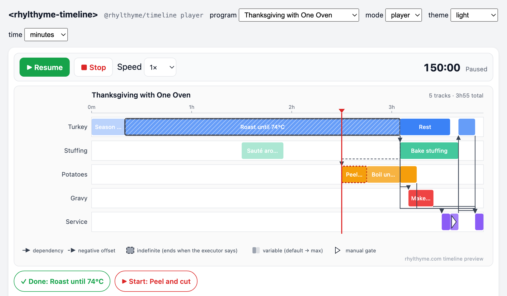
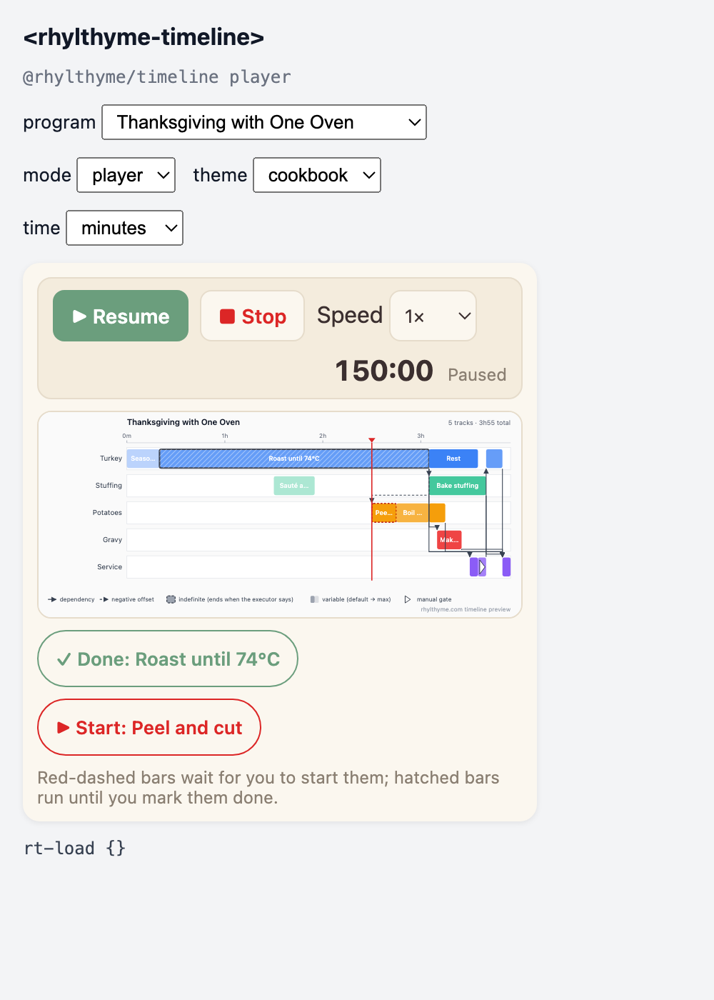
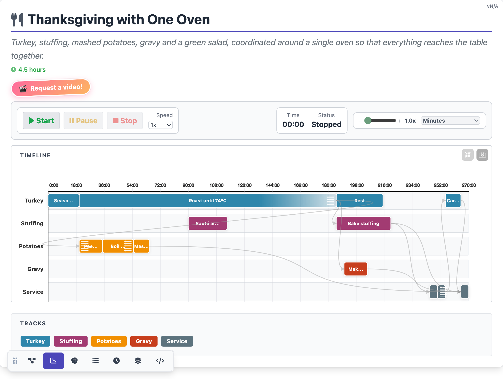
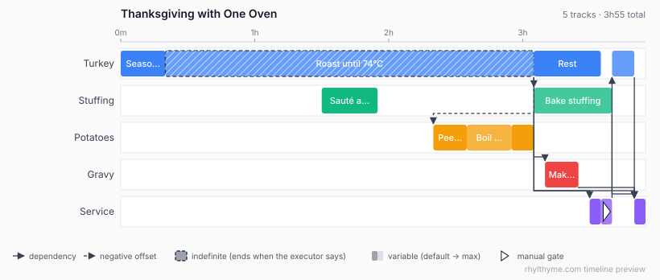
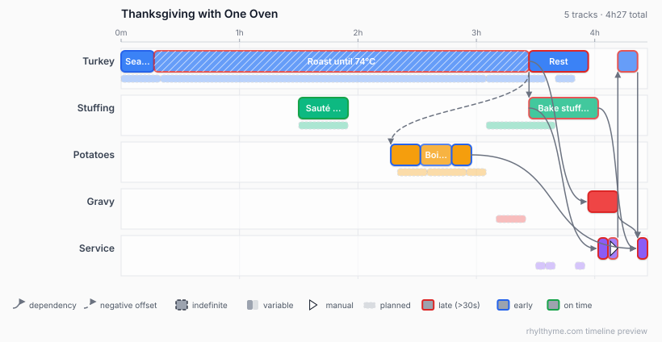
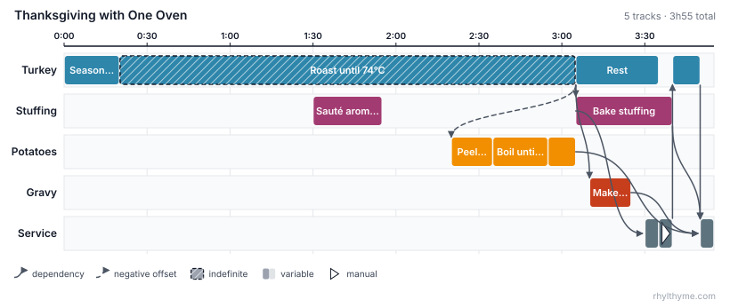
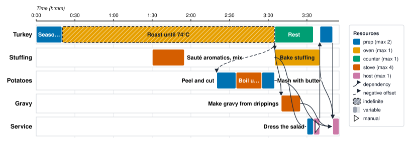

# @rhylthyme/timeline

Timing engine, static Gantt renderer and `<rhylthyme-timeline>` player
Web Component for [Rhylthyme](https://www.rhylthyme.com) programs. Zero
dependencies; the engine is one UMD file that runs in the browser, Node and ESM.

A Rhylthyme program is JSON describing parallel **tracks** of sequential
**steps**, each with a duration (fixed, variable or indefinite) and a start
trigger (program start, an offset, after another step's end or start,
after with buffer, manual, on abort, or all/any of several). This package
turns that into resolved start and end times and draws them.

## What it produces

Four outputs from the same engine, shown here for
[`thanksgiving_one_oven.json`](test/fixtures/programs/thanksgiving_one_oven.json).

### 1. The `<rhylthyme-timeline>` element (2.0 beta)

A Web Component that plays a program: wall-clock-anchored cursor, Start /
Pause / Stop, speed, manual gates and indefinite steps handled by the
person following along, and events for the host page. Timings come from
the engine (`computeStepTimings(program, { actual, now })`), so what the
player shows is what the validator plans, adjusted for what has actually
happened.



```html
<script src="https://cdn.jsdelivr.net/npm/@rhylthyme/timeline@2.0.0-beta.7/src/index.js"></script>
<script src="https://cdn.jsdelivr.net/npm/@rhylthyme/timeline@2.0.0-beta.7/src/element.js"></script>

<rhylthyme-timeline src="thanksgiving.json" mode="player" speed="1" time-format="minutes"></rhylthyme-timeline>
<script>
  const el = document.querySelector('rhylthyme-timeline');
  // or: el.program = programObject;
  el.addEventListener('rt-step-began', (e) => console.log('began', e.detail.stepId, 'at', e.detail.time, 'by', e.detail.by));
  el.addEventListener('rt-step-ended', (e) => console.log('ended', e.detail.stepId, 'at', e.detail.time, 'by', e.detail.by));
  el.addEventListener('rt-complete', () => console.log('all done'));
</script>
```

Try it: `open examples/player.html` (program, mode, theme and time-format
pickers, event log). `?at=9000&theme=dark` positions it for screenshots.

| Attribute | Values |
|---|---|
| `program` (property) / `src` | program object, or a URL to fetch |
| `mode` | `player` (default) or `static` (the Gantt alone, no controls or cursor) |
| `speed` | playback multiplier, default `1` |
| `time-format` | `minutes` (`mm:ss`), `seconds`, `hours` (`h:mm:ss`), `clock` (wall time from `start-at` or the moment Start was pressed) |
| `start-at` | ISO 8601 start time for `clock` format |
| `theme` | `light`, `dark`, `cookbook`; or override `--rt-bg`, `--rt-fg`, `--rt-accent`, `--rt-border`, `--rt-panel`, `--rt-muted` |
| `view` | `timeline` (itinerary and DAG views are planned) |

Methods: `start()`, `pause()`, `stop()`, `toggle()`, `seek(seconds)` (while
paused), `startStep(id)`, `completeStep(id)`, `tick()`, `setClock(fn)`.
Read-only: `currentTime`, `status`, `timings`, `stepStates`. Read/write:
`labels` (translations, below). Events (all bubble and cross the shadow
boundary):

| Event | `detail` | Fires |
|---|---|---|
| `rt-load` | `{program}` | a program was set or fetched |
| `rt-start` / `rt-pause` | `{time}` | the transport started or resumed / paused |
| `rt-stop` | `{}` | `stop()`: the run is over and the player rewinds |
| `rt-tick` | `{time}` | every clock tick while running |
| `rt-step-began` | `{stepId, time, by}` | **every** step began, once per run; `by` is `person` (`startStep()`) or `plan` (its own trigger) |
| `rt-step-ended` | `{stepId, time, by}` | **every** step ended, once per run; `by` is `person`, `timer`, `trigger`, `abort` or `dropped` (below) |
| `rt-seek` | `{from, to}` | `seek()` changed the time (program-clock seconds), after the step events it fired |
| `rt-step-start` | `{stepId, time}` | `startStep()` only: a manual gate or negative-offset hand-off |
| `rt-step-complete` | `{stepId, time, automatic}` | only the steps the player finishes: `completeStep()`, a variable step's `maxSeconds`, a hand-off cap |
| `rt-complete` | `{time}` | every step is done |
| `rt-run-record` | `{record, outcome}` | one run record per run |
| `rt-factors` | `{factors, skipped, source}` | variance-factor answers were given |

`rt-step-began` and `rt-step-ended` are what a host follows a run with (an
ELN ticking off its own copy of each step, a notifier, a dashboard). They
fire for every step, replicate instances included, whether a person, the
plan or a timer caused the transition. `time` is the transition's own
second on the program clock, not the tick that noticed it, and the
transitions one tick finds fire in time order (at the same second an end
comes before the begins it makes way for). `rt-step-ended`'s `by` is the
run record's `endedBy`, with `executor` called `person`:

| `by` | run record `endedBy` | Cause |
|---|---|---|
| `person` | `executor` | `completeStep()` (the *Done* button) |
| `timer` | `timer` | a fixed duration, or a variable step's `maxSeconds`, ran out |
| `trigger` | `trigger` | a negative-offset hand-off capped the step |
| `abort` | `abort` | `stop()` while the step was running |
| `dropped` | *(none: the step stays open)* | the run was dropped while the step was running: program replaced, element removed |

A forward `seek()` fires what it passes over; seeking back fires nothing,
and nothing fires twice in a run. `stop()` ends the run, so the next
`start()` fires every step again.

#### Delivery guarantees and policies

Three situations could break the simple "every step begins once and ends
once" picture. Each has a fixed rule.

**1. Dropped runs end their running steps with `by: 'dropped'`.**

- *Rule.* A run is dropped when the program is replaced (setting
  `program`, or a new `src` once it has loaded) or when the element is
  removed from the document for good, while a run is under way: started
  and not yet stopped or completed, or paused after a `seek()` that
  began steps. An element that is idle (never started, stopped,
  completed) has nothing to drop; removing it or replacing its program
  fires nothing and its next `start()` is an ordinary fresh run. If
  steps are running when a run is dropped, each gets one
  `rt-step-ended` with `by: 'dropped'`, in program order, the same order
  `stop()` uses for its `abort` ends. Its `time` is `currentTime` (the
  program-clock second the run was dropped at), or the step's own begin
  second if that is later, which happens after a backward `seek()`
  while paused: an end is never earlier than its begin (`abort` ends are
  clamped the same way). Any transitions already queued are delivered
  first. Then comes the run's `rt-run-record` with outcome `abandoned`.
  The run record itself is unchanged: the dropped steps keep an open
  interval (an `actual.start`, no end, no `endedBy`).
- *After the drop, the run is inert.* Nothing else fires for that run:
  `start()`, `pause()`, `toggle()` and `seek()` do nothing, and
  `startStep()` and `completeStep()` return `false`. The element keeps
  the `status` it had (`running` or `paused`) and its clock stays still.
  Two things move on from it: setting a program (a fresh element state),
  or `stop()`, which rewinds and fires only `rt-stop` (no `abort` ends,
  since the steps already ended `dropped`, and no second run record).
  After that, `start()` is a fresh run.
- *Moves are not drops.* The element decides in a microtask queued when
  it is disconnected. If it is back in a document by then, it was
  moved: the run goes on with its clock and no events fire. That covers
  `appendChild` or `insertBefore` to another parent, and `remove()`
  followed by a re-insert **in the same synchronous code**. Any `await`
  between the two (even `await null` or a resolved promise), a
  `setTimeout`, or a framework that re-inserts in a later render counts
  as removal for good: the run is dropped as above and the re-inserted
  element is left inert. Pausing first does not help (a paused run is
  dropped too); to move an element across an `await`, re-insert it
  before awaiting, or keep it in the document and hide it with CSS. Because of this, the `abandoned`
  run record of a removed element arrives a microtask after `remove()`,
  not during it. A program replacement drops the run at once, inside
  the setter.
- *Why.* Without it, a host that counts begins minus ends would be left
  with steps "in progress" forever. With it, begins and ends always
  pair, so in-progress counters and "what is running now" lists stay
  exact.
- *Consequences for host pages.*
  - `dropped` is not `abort`. Nobody pressed Stop: the person may still
    be stirring the pot, the page just stopped watching. Don't record
    `dropped` as "cancelled" or as a finish time.
  - A framework re-render that swaps the program (React passing a new
    `program` object, for example) produces `dropped` ends for the old
    run. If you only want real stops, filter: `if (e.detail.by ===
    'dropped') return;`. Passing the same object again is still a new
    program; keep the reference stable to keep the run.
  - For the authoritative history keep using the run record: it says
    `abandoned`, with those steps open.

**2. `seek()` never fires a step twice; it fires `rt-seek` instead.**

- *Rule.* Each step fires `rt-step-began` and `rt-step-ended` at most
  once per run. A forward seek fires the transitions it passes over; a
  backward seek fires no step events, and seeking forward again fires
  only what has not fired yet. Every seek that changes the time fires
  one `rt-seek` with `{from, to}` in program-clock seconds, after the
  step events it caused. A seek to the current time, a seek while
  running (ignored), or a seek on a dropped run (ignored) fires nothing.
- *Seeks from handlers.* A handler may call `seek()` while the events of
  an earlier seek are being delivered. The inner seek's events (its step
  events, then its own `rt-seek`) are queued behind the outer seek's
  `rt-seek`, so the `rt-seek` events arrive in the order the seeks were
  made and each one's `from` is the previous one's `to`. A handler that
  reacts to `rt-step-ended` of the outer seek therefore sees the outer
  `rt-seek` only after it has returned, followed by the inner one.
- *Why.* The step events describe what happened in the run, and a seek
  does not undo what happened. Re-firing would turn every scrub of the
  playhead into duplicate entries.
- *Consequences for host pages.* Record-keeping hosts (an ELN, a
  notifier, an audit log) never see duplicates and can ignore
  `rt-seek`. Hosts that mirror the playhead (a demo, a training view, a
  "now" highlight) should resync on `rt-seek` by reading `stepStates`
  (and `currentTime`), because after a backward seek steps that ended
  are pending or active again on screen without any step event saying
  so.

**3. A `stop()` from a handler takes effect after the current batch.**

- *Rule.* The transitions found together (one tick, one seek, one
  `start()`) are delivered as one ordered batch. If a handler calls
  `stop()` in the middle of it, the rest of the batch is delivered first,
  then the `abort` ends of the steps still running, then `rt-stop`.
  Nothing fires after `rt-stop`. Other calls from handlers
  (`completeStep()`, `pause()`…) queue their events behind the batch in
  the same way.
- *Why.* The batch describes things that already happened before the
  stop, and the run record holds them. Cutting the batch short would make
  the events disagree with the record.
- *Consequences for host pages.* Events always agree with the run
  record. A handler that stops the run (for example on the first
  `rt-step-ended` it sees) will still receive the later transitions of
  that batch before the `abort` ends (`el.status` still reads `running`
  while they are delivered), so set your own flag if a handler should
  ignore them.

**Translating the player.** Every piece of text the player writes itself (not the program's own names) is a key of one
table; set `labels` to a partial object and the keys you leave out stay
English. Use a string, with `{0}`, `{1}`… for arguments, or a function:

```js
el.labels = {
  start: 'Démarrer', pause: 'Pause', resume: 'Reprendre', stop: 'Arrêter',
  speed: 'Vitesse', statusRunning: 'en cours',
  startStep: (name) => `Démarrer : ${name}`,
  doneStep: 'Terminé : {0}',
};
console.log(Object.keys(el.labels)); // the full key list, with the text in effect
```

Without script, put the same table in the `labels` attribute as JSON.
Only strings fit in an attribute (no functions); `{0}`, `{1}`… work the
same way:

```html
<rhylthyme-timeline src="dinner.json" locale="fr"
  labels='{"stop": "Arrêter", "resume": "Reprendre", "startStep": "Démarrer : {0}"}'>
</rhylthyme-timeline>
```

The attribute and the property are two ways to supply one table, as with
`data-factors` and `factors`: whichever was set last replaces it
wholesale (the two are not merged), and reading `el.labels` returns the
table in effect, whichever supplied it. Setting the property does not
rewrite the attribute. An attribute value that is not a JSON object is
ignored with one `console.warn` and the labels in effect stay; an empty
value means no labels. Removing the attribute clears the labels it
supplied, but leaves a table set through the property after it. Writing
the attribute again with the value it already has counts as setting it.
If script set `labels` before `element.js` defined the element and the
attribute was also there, the order cannot be known: the property wins.

The keys are typed as `RhylthymeTimelineLabels` in
`@rhylthyme/timeline/element`: transport (`start`, `pause`, `resume`,
`stop`, `speed`, `speedOption`), status (`statusStopped`, `statusRunning`,
`statusPaused`, `statusCompleted`), step actions (`startStep`, `doneStep`,
`instance`, `groupProgress`, `actionsHint`), the empty state (`loading`,
`noProgram`, `loadError`), the variance-factor form (`factorsTitle`,
`factorsHint`, `factorSkip`, `factorsStart`, `factorNotNumber`,
`factorNotInteger`, `factorNotOneOf`) and the chart: its subtitle
(`chartSubtitle(tracks, total, totalSeconds)`) and legend terms
(`legendDependency`, `legendNegativeOffset`, `legendIndefinite`,
`legendVariable`, `legendManual`, `legendBarrier`, `legendBarrierAny`,
`legendInFlight`). Chart keys reach the renderer only when you set them,
so the English chart is unchanged; translating a legend term draws the
renderer's configurable legend, which lists the step kinds the program
uses. Program content (track and step names) and the small brand mark
are not labels. Text is escaped, never parsed as HTML. In the
`noProgram` template `{0}` and `{1}` are drawn as `<code>program</code>`
and `<code>src</code>`; a function receives `'program'` and `'src'` and
its text is shown as is. Setting `labels` while the variance-factor form
is open keeps what was typed and any error on screen, re-worded.

Times are fixed-format ASCII (`mm:ss`, `HH:MM:SS`, `45s`) unless you set
the `locale` attribute (or property): `locale="fr"` formats the clock,
durations and the speed options with `Intl` in that locale, and an
empty value or `"auto"` uses the browser's. `formatTime(seconds)`
returns the clock text, and you can replace it on an instance. The glyphs (▶ ❚❚ ■ ✓) are not part of the text: they are drawn
beside it with `aria-hidden="true"`, and each button's `aria-label` is
the text alone. The status element keeps the untranslated state in
`data-status` for styling.

How the player treats step kinds, matching the rhylthyme.com runner:

- **Manual gates** (`startTrigger.type: "manual"`) and **negative-offset
  hand-offs** wait for `startStep()`. On a stopped player `startStep()` starts a
  run first, so the step begins on a moving clock. Until then they float forward with
  the cursor (shown as a red dashed bar with a *Start* button), and
  everything downstream moves with them.
- **Indefinite steps** run until `completeStep()` (*Done* button).
  Starting a negative-offset step caps the step it refers to at
  now + |offset|, so "peel the potatoes 45 min before the roast is due
  out" ends the roast 45 min after you start peeling.
- **Variable steps with a `triggerName`** can be finished after
  `minSeconds` and finish on their own at `maxSeconds`.
- When every step is done the player pauses after a 3 s grace period with
  status `completed`.



The dark preset inverts the chart with a CSS filter; theming the SVG
itself is on the roadmap. `test/element.test.js` drives the element in
headless Chrome through a full Thanksgiving run with a fake clock (CI has
Chrome; locally it is skipped unless a Chrome binary is found or
`CHROME_BIN` is set).

### 2. The classic player page: `node player/build.js`

The page rhylthyme.com serves in its player: a timeline with a live cursor,
Start / Pause / Stop and speed controls, zoom, and a tab bar for the
itinerary, dependency graph, resources, clock, layers and JSON editor views.
This is a Chrome screenshot of the page `player/build.js` wrote:



```bash
node player/build.js test/fixtures/programs/thanksgiving_one_oven.json thanksgiving-player.html
open thanksgiving-player.html
```

The output is one self-contained HTML file (D3 v5 and Font Awesome load
from CDNs). Pass `--environment env.json` to merge an environment's
resource constraints the way the server does. From code:

```js
const { buildPlayerHtml } = require('@rhylthyme/timeline/player');
const html = buildPlayerHtml(program /*, environment */);
```

`player/template.html` is exported verbatim from the server's
`web_visualizer.py`; `player/build.js` ports the Python that fills its
slots. `npm test` rebuilds every corpus program and checks the HTML is
byte-identical to the server's (39 programs, sha256). Two things to know:
the player keeps the server's own step placement, which puts a
negative-offset step at the start of the step it refers to rather than
where `computeStepTimings` puts it (unifying the two is on the roadmap),
and the "Switch kitchen" button messages a parent window, so it does
nothing when the file is opened on its own.

### 3. The static SVG: `renderTimelineSvg` (Node) and `renderTimeline` (browser)

One Gantt drawing, no dependencies. `renderTimelineSvg(program)` returns
it as an SVG string; `renderTimeline(container, program)` is a two-line
wrapper that calls the same function and sets the container's
`innerHTML` to the result, so what a page shows is exactly this file:



Rows are tracks and bars are steps at their resolved times. The roast is
*indefinite* (hatched): it ends when the cook says so, and everything after
it is planned against its default duration. Arrows are cross-track
dependencies; the dashed one is a negative offset ("peel the potatoes
45 min before the roast is due out"). The flag on "Guests seated" is a
*manual* gate; "Serve" waits for all four dishes. The oven has capacity
one, so the stuffing bakes only after the turkey comes out.

#### Planned vs actual, from a recorded run

Pass a run record (rhylthyme-spec's `runs` schema, written by
`rhylthyme run` and by the element player) as `run` and the same drawing
becomes a comparison: each bar is where the step *actually* ran, with a
thin ghost bar underneath at the position the plan predicted.

```js
const svg = Rhylthyme.renderTimelineSvg(program, { run: record });
```



Here the cook finished the prep 200 s early (blue), the stuffing prep ran
exactly to plan (green), and the indefinite roast ran 25 minutes past its
`defaultSeconds`, so the steps that wait for it to *finish* are late (red)
— the ghost bars show by how much. The potato chain hangs off the roast by
a negative offset, which the runtime fires from the roast's *projected*
end rather than its real one, so it runs early instead (blue). A bar is
outlined green when its end is
within `deviationThreshold` seconds of the plan (default 30), blue when it
is earlier, red when it is later, and carries
`data-deviation="early" | "late" | "on-time"` with
`data-deviation-seconds` so a page can style or tabulate the same thing.

`{ run }` is shorthand for `{ timings: timingsFromRun(program, record),
baseline: computeStepTimings(program) }`; pass `baseline` directly to
compare against any other timings map (a previous run, or the `planned`
values frozen in the record). `rhylthyme runs show <run> --svg out.svg`
writes exactly this file from the CLI.

From Node, [`examples/render.js`](examples/render.js) writes the file and
prints every step's resolved start and end:

```bash
node examples/render.js test/fixtures/programs/thanksgiving_one_oven.json thanksgiving.svg
```

```
   0:00 –   20:00  Turkey: Season and truss
  20:00 – 185:00  Turkey: Roast until 74°C
 185:00 – 215:00  Turkey: Rest
 220:00 – 230:00  Turkey: Carve and serve
  90:00 – 115:00  Stuffing: Sauté aromatics, mix
 185:00 – 220:00  Stuffing: Bake stuffing
 140:00 – 155:00  Potatoes: Peel and cut
 155:00 – 175:00  Potatoes: Boil until tender
 175:00 – 185:00  Potatoes: Mash with butter
 190:00 – 205:00  Gravy: Make gravy from drippings
 210:00 – 215:00  Service: Dress the salad
 215:00 – 220:00  Service: Guests seated
 230:00 – 235:00  Service: Serve
wrote thanksgiving.svg
```

For a PNG, `npm i @resvg/resvg-js` and give the output a `.png` name (or
run any SVG converter, e.g. `rsvg-convert -w 1640 -f png -o out.png thanksgiving.svg`).
Point it at your own program JSON to render that instead; the
[example corpus](test/fixtures/programs) has 39 more.

#### Looks, palettes and the legend

The default drawing is unchanged from earlier versions (and pinned byte for
byte by the tests). Two more looks are opt-in with `style`:

| `style` | For | What changes |
|---|---|---|
| `classic` (default) | existing embeds | nothing |
| `web` | previews that sit next to the interactive timeline | its `vivid` palette, flat bars, dark axis with clock labels (`0:30`, `1:00`), a legend that lists only what the drawing contains, `<title>`/`<desc>` and per-bar tooltips |
| `publication` | papers, slides, posters | as `web`, plus: white page, no brand mark, no title (the caption carries it), an axis title, Helvetica/Arial, track names never cut, and a step name that does not fit its bar is set beside it instead of being truncated |





```js
const svg = Rhylthyme.renderTimelineSvg(program, {
  style: 'publication',
  colorBy: 'task',                 // colour by resource instead of by track
  palette: 'okabe-ito',            // or an array of hex colours
  colors: { oven: '#b91c1c' },     // pin a track id, track name or task
  fontScale: 1.2,                  // for a figure that will be shrunk to a column
  startAt: '2026-11-26T14:00:00',  // wall-clock axis instead of elapsed time
  legend: {
    position: 'right',             // 'bottom' (default) | 'top' | 'right' | 'none'
    title: 'Resources',
    items: ['tasks', 'dependency', 'indefinite'],   // exactly these, in this order
    labels: { dependency: 'Finish-to-start' },
    frame: true,
  },
});
```

| Option | Values | Default |
|---|---|---|
| `style` | `classic`, `web`, `publication` | `classic` |
| `palette` | `vivid`, `muted`, `tableau`, `google`, `pastel`, `d3`, `cookbook` (the interactive timeline's palettes, value for value), `okabe-ito` (colour-blind safe), `grayscale`, `classic`, or an array | per style |
| `colorBy` | `track`, `task` | `track` |
| `colors` | `{ key: hex }` keyed by track id, track name or task | none |
| `legend` | `false`, or `{ position, items, labels, title, columns, frame, onlyUsed, capacity, fontSize }` | automatic |
| `legend.items` | any of `tracks`, `tasks`, `dependency`, `negative-offset`, `indefinite`, `variable`, `manual`, `barrier`, `barrier-any`, `in-flight`, `planned`, `late`, `early`, `on-time` | the keys the drawing uses; `tasks` first when `colorBy: 'task'` (with each resource's `maxConcurrent`) |
| `title`, `subtitle` | string, or `false` to omit | program name, "N tracks · total" |
| `brand` | boolean | on, except `publication` |
| `background` | hex, or `'none'` | per style |
| `fontFamily`, `fontScale` | CSS family list; 0.5–3 | per style; 1 |
| `fontWidthFactor` | 0.8–1.6: multiply the text-width estimates when the rasteriser will use a wider face than Helvetica/Arial (about 1.14 for DejaVu Sans) | 1 |
| `width`, `rowHeight`, `labelWidth` | SVG units | 820; 46; fits the longest track name |
| `timeFormat` | `clock`, `minutes` | per style |
| `startAt` | `Date` or ISO string: label the axis with wall-clock times | none |
| `tickInterval`, `axisTitle`, `grid` | seconds; string or `false`; boolean | automatic |
| `labelOverflow` | `truncate`, `hide`, `outside` | `outside` for `publication`, else `truncate` |
| `showDurations`, `tooltips` | boolean | off; on for `web` |

Passing a `legend` object or `colorBy: 'task'` in the classic look swaps
its fixed one-line key for the configurable one and leaves the rest alone.
`Rhylthyme.PALETTES` exports the palettes and `Rhylthyme.STYLES` the look
names.

From the command line (`npx rhylthyme-render`, or `node bin/render.js`):

```bash
rhylthyme-render program.json -o figure.pdf --style publication \
    --color-by task --palette okabe-ito --legend right --legend-title Resources
rhylthyme-render program.json --run run.json -o overlay.png --style web --scale 3
rhylthyme-render --help
```

A rasteriser with no fonts draws no text at all: `@resvg/resvg-js` on a
serverless host needs `font: { fontFiles: [...], loadSystemFonts: false }`
and a matching `fontFamily` (the Rhylthyme MCP server bundles DejaVu Sans
for this).

`.pdf` needs `rsvg-convert` on the PATH (vector output, fonts embedded);
`.png` uses it too, or `@resvg/resvg-js` when it is installed. Text is real
text, not outlines, so a figure can still be edited in Illustrator or
Inkscape. Label fitting uses estimated text widths (there is no DOM to
measure with), so check a final figure by eye.

In a browser, open [`examples/index.html`](examples/index.html) (no server
or build needed): it loads `src/index.js`, calls `renderTimeline`, and has
a dropdown of six example programs.

### 4. Just the numbers: `computeStepTimings(program)`

What both renderers are drawn from (seconds from program start;
`resolved` is `false` only for cycles or dangling references):

```js
const R = require('@rhylthyme/timeline');
R.computeStepTimings(program)
// {
//   'turkey-prep':  { start: 0,     end: 1200,  duration: 1200, trackId: 'turkey',   resolved: true },
//   'turkey-roast': { start: 1200,  end: 11100, duration: 9900, trackId: 'turkey',   resolved: true },
//   'potatoes-peel':{ start: 8400,  end: 9300,  duration: 900,  trackId: 'potatoes', resolved: true },  // roast end − 45 min
//   'guests-seated':{ start: 12900, end: 13200, duration: 300,  trackId: 'service',  resolved: true },  // manual gate, planned after the previous step
//   'serve':        { start: 13800, end: 14100, duration: 300,  trackId: 'service',  resolved: true },  // all four dishes done
//   ...
// }
```

### 5. The plan as a list: `itinerary(program, opts?)`

For a to-do list, a notification scheduler or a calendar export: every
step (replicate instances expanded) in plan order, with its name, its
track's name, the authored step an instance came from and, given
`startAt` or `finishAt`, wall-clock times. It is in the core, so there is
no need to load `./schedule` for it, and it agrees with
`analyzeSchedule(...).steps` (a test checks every example program), with
one exception: a LabMCP instrument step with no duration is timed by the
core's generic instrument estimate, while `analyzeSchedule` uses the LabMCP
catalogue's. For those programs use the `itinerary` exported by
`@rhylthyme/timeline/schedule`, which applies the catalogue estimates first
and always agrees with `analyzeSchedule`.

```js
R.itinerary(program, { finishAt: '2026-11-26T18:00:00-05:00' })
// [
//   { stepId: 'turkey-prep', name: 'Season and truss', trackId: 'turkey', trackName: 'Turkey',
//     instanceOf: null, instanceIndex: null, startSeconds: 0, endSeconds: 1200, durationSeconds: 1200,
//     needsStart: false, needsFinish: false, task: 'prep',
//     startAt: '2026-11-26T19:05:00.000Z', endAt: '2026-11-26T19:25:00.000Z' },
//   ...
// ]
```

## Usage

For a whole web app (the player element in React, charts, timings, and
the hosted validator and analyzer from a backend), see
[Embed Rhylthyme in your app](https://docs.rhylthyme.com/development/embedding/).

In a page, without a build step:

```html
<script src="https://cdn.jsdelivr.net/npm/@rhylthyme/timeline@2.0.0-beta.7/src/index.js"></script>
<div id="timeline"></div>
<script>
  Rhylthyme.renderTimeline(document.getElementById('timeline'), program);
</script>
```

```js
// Node / bundlers, CommonJS
const Rhylthyme = require('@rhylthyme/timeline');
const timings = Rhylthyme.computeStepTimings(program);
const svg = Rhylthyme.renderTimelineSvg(program);

// ES modules: every function is a named export too
import { computeStepTimings, renderTimelineSvg } from '@rhylthyme/timeline';
```

The element registers itself on import, in a bundler as well as from a
script tag: `import '@rhylthyme/timeline/element'`.

TypeScript types ship with the package (`types/`): the `Program` shape,
the engine and renderer, the element (`HTMLElementTagNameMap` and typed
`rt-*` events) and `./schedule`.

### Validate and analyze: `@rhylthyme/timeline/schedule`

The validator and analyzer that `mcp.rhylthyme.com` runs, as a library:
the same findings (each with a `fix` hint), critical path, resource
conflicts and wall-clock plan, with no server and no dependencies.

```js
import { validateProgram, analyzeSchedule } from '@rhylthyme/timeline/schedule';

const v = validateProgram(program);   // { valid, errors, warnings, info, stats }
if (!v.valid) console.log(v.errors.map((e) => `${e.code}: ${e.message} (fix: ${e.fix})`));

const a = analyzeSchedule(program, { finishAt: '2026-11-26T18:00:00-05:00' });
// { makespanSeconds, criticalPath, resourceConflicts, steps: [{ stepId, startAt, ... }], ... }
```

`validateProgram` expands replicates first and checks the JSON Schema on
the expanded program, as the Python validator does. The program schemas from
rhylthyme-spec ship inside the package (`src/schedule/schemas/`), and a
small built-in checker applies them with the semantics of Python's
`jsonschema` (Draft 7; `format` is not checked). `schemaVersion` picks the
schema: `0.3.x` uses 0.3.0-alpha, anything else 0.2.0-alpha. Each failure
is an error with the code `schema_<keyword>` (`schema_required`,
`schema_type`, `schema_oneOf`, `schema_additionalProperties`, ...), a
`where` path such as `tracks[0].steps[1].duration` and a `fix`. Paths
point at the program as written: a finding on a copy that `replicates`
makes (`"boil-r2"`) is reported once, at the step it is copied from, and
its message names the copy. Because the expanded program is what is
checked, an authored shape the expander resolves is accepted (a number as
a replicated step's name becomes `"42 (1 of 2)"`; a track without steps is
left out, with an `empty_track` warning), while a program the expander
cannot run on (a track with no `trackId`, a replicated step with no `name`
or `stepId`) is checked as written. A problem the schema reports is not
reported again by the logic checks: a missing `programId`, track `name` or
`startTrigger`, an unknown duration or trigger type and a malformed alert
are `schema_*` findings only. Two rules
the logic checks never enforced come from the schema: a program needs
`resourceConstraints` (an empty list is fine), an `environment` or an
`environmentType`, and an indefinite step needs `defaultSeconds`. A value that
cannot be written as JSON (a circular reference, a BigInt) gets the single
error `not_json` instead of a schema check. Patterns are read as Python's
`re.search` reads them (`$` also matches before a final newline).

Every code `validateProgram` can report is catalogued in `findingCodes`
(`src/schedule/finding-codes.json`): per code its area, severities, a
summary, an explanation, a program fragment that triggers it, the fix, and
what Python's `rhylthyme` validator reports for the same program. An app
can show the explanation next to a finding:

```js
import { validateProgram, findingCodes } from '@rhylthyme/timeline/schedule';

for (const f of validateProgram(program).errors) {
  const about = findingCodes.codes[f.code];   // { area, severity, summary, explanation, examples, fix, python }
  console.log(`${f.code}: ${f.message}\n  ${about.summary} ${about.fix}`);
}
```

`test/finding-codes.test.js` keeps the catalogue complete both ways: every
code in the source is in it, and every example in it makes `validateProgram`
report its code with its severity. A few codes the source can emit but no
program reaches today (`bad_trigger`, and `schema_<keyword>` for keywords
the bundled schemas do not assert) are listed with `reachable: false` and
the reason. The rendered reference is docs/development/finding-codes.md in
rhylthyme-docs. These are the codes of this package's `validateProgram`;
the hosted MCP server's `validate_program` (rhylthyme-mcp's
`mcp-api/schedule.js`) still runs its own validator, whose codes differ
(`missing_program_id` where this one reports `schema_required`, for one).

```js
import { schemaFindings, programSchema, checkJsonSchema } from '@rhylthyme/timeline/schedule';

schemaFindings(program);              // only the schema_* findings
checkJsonSchema(value, programSchema('0.3.0-alpha'));
// [{ keyword, path: ['tracks', 0, 'name'], message, fix }], [] when valid
```

Both functions are synchronous. The LabMCP instrument catalogue (about
350 KB) that checks LabMCP instrument steps (`instrument.toolType`
starting with `labmcp-`) is loaded separately in the browser:

- In Node (`require` or `import` of `@rhylthyme/timeline/schedule`) it is
  registered for you; nothing changes.
- In a bundler, the `browser` export condition gives the module without it.
  Programs without LabMCP steps never need it. For those with them, import
  `@rhylthyme/timeline/schedule/labmcp-catalog` once, eagerly or lazily
  (a separate chunk), before validating:

  ```js
  import { validateProgram, labmcp } from '@rhylthyme/timeline/schedule';
  if (program.tracks.some((t) => t.steps.some(labmcp.isLabmcpStep)) && !labmcp.hasCatalog()) {
    await import('@rhylthyme/timeline/schedule/labmcp-catalog');
  }
  const v = validateProgram(program);
  ```

  Until it is loaded, each LabMCP step gets an
  `instrument_catalog_not_loaded` warning (not an error) instead of its
  call checks; once it is loaded the findings are the same as in Node.
  `labmcp.registerCatalog(json)` registers a catalogue you load yourself.

In a page without a build step, `browser/schedule.js` is the same module
as one script that sets `window.RhylthymeSchedule`, and
`browser/labmcp-catalog.js` adds the catalogue (before or after it):

```html
<script src="https://cdn.jsdelivr.net/npm/@rhylthyme/timeline@2.0.0-beta.7/browser/schedule.js"></script>
<!-- only for programs with LabMCP instrument steps: -->
<script src="https://cdn.jsdelivr.net/npm/@rhylthyme/timeline@2.0.0-beta.7/browser/labmcp-catalog.js"></script>
<script>
  const { valid, errors } = RhylthymeSchedule.validateProgram(program);
</script>
```

Sizes, before and after the catalogue was split out (2.0.0-beta.6 →
unreleased):

| | before | after |
|---|---|---|
| `browser/schedule.js` | 465 KB | 223 KB (+ 244 KB `browser/labmcp-catalog.js` when needed) |
| esbuild bundle of `./schedule` (`--platform=browser`) | 658 KB | 209 KB |
| same, minified | 338 KB | 112 KB (+ 226 KB lazy catalogue chunk when needed) |

It agrees with the Python validator in the `rhylthyme` package:
`test/parity.test.js` gives every program in rhylthyme-examples to both,
along with schema-breaking mutations of each (of plain and of replicated
tracks and steps), and requires the same verdict (CI runs it here and in
`rhylthyme`).

## API

| Function | Returns |
|---|---|
| `computeStepTimings(program, opts?)` | `{ [stepId]: { start, end, duration, trackId, resolved } }` in seconds from program start. `resolved` is `false` when a trigger could not be satisfied (cycle or dangling reference); such steps are placed at `t = 0`. `opts.actual = { [stepId]: { start?, end? } }` overrides the plan with what actually happened; `opts.now` makes unstarted manual gates float to the current time and started indefinite steps stretch to it. |
| `renderTimelineSvg(program, opts?)` | SVG markup (string). Looks, palettes, `colorBy` and the configurable legend are described under [Looks, palettes and the legend](#looks-palettes-and-the-legend). `opts = { arrows, marks, legend }`, all default `true`: cross-track dependency arrows (dashed for negative offsets), hatched indefinite steps, faded variable-step extensions to their maximum, a flag on manual gates, and a one-line legend (dependency, negative offset, indefinite, variable, manual). Player options: `timings` (precomputed), `now` (draws the cursor), `states` (`{ [stepId]: 'done' \| 'active' \| 'waiting' }`), `width`. Planned-vs-actual options: `baseline` (a second timings map drawn as a ghost bar under each step, `class="rt-baseline"`, with every bar tagged `data-deviation` / `data-deviation-seconds`), `deviationThreshold` (seconds inside which a step counts as on time, default 30) and `run` (a run record: shorthand for `timings` from it plus `baseline` from the plan). Bars carry `class="rt-bar"` and `data-step`. Without `baseline`/`run` the output is byte-identical to earlier versions. |
| `renderTimeline(container, program, opts?)` | Injects the SVG into a DOM element and returns the markup. |
| `actualFromRun(record, program?, opts?)` | `{ [stepId]: { start, end } }` from a run record, keyed by expanded step id, ready to pass as `computeStepTimings`' `actual`. `opts.endsOnly` keeps only the ends, which is what a replay check feeds back so that every start has to come out of the trigger graph. Arguments may be given in either order. |
| `timingsFromRun(program, record, opts?)` | `computeStepTimings(program, { actual: actualFromRun(record, program, opts) })`. |
| `itinerary(program, opts?)` | `[{ stepId, name, trackId, trackName, instanceOf, instanceIndex, startSeconds, endSeconds, durationSeconds, startAt?, endAt?, needsStart, needsFinish, task }]`, one entry per expanded step, sorted by start then name. `instanceOf` / `instanceIndex` link a replicate instance, of a step or of its track, to its authored step (`null` otherwise). `opts.startAt` anchors the plan's start, `opts.finishAt` (wins) its end (an ISO string, a `Date` or epoch ms), and then `startAt` / `endAt` are ISO 8601 UTC strings, exactly as `analyzeSchedule` reports them; without an anchor they are absent. `opts.actual` and `opts.now` go to `computeStepTimings`. LabMCP steps with no duration get the generic instrument estimate; `itinerary` from `./schedule` applies the LabMCP catalogue estimates, as `analyzeSchedule` does. |
| `runtimeStepId(entry, knownIds?)` | The expanded step id a record entry refers to: `<stepId>-r<instance>` for a replicated step, `<stepId>` otherwise, confirmed against `knownIds` when given. Python twin: `rhylthyme.history.replay.record_step_id`. |
| `buildPlayerHtml(program, environment?)` (from `@rhylthyme/timeline/player`) | The interactive visualizer page as an HTML string, identical to the server's. Needs Node (reads `player/template.html`). |
| `stepNeedsStart(step)` / `stepNeedsFinish(step)` | Whether the executor must start the step (manual gate, negative offset) / must end it (indefinite, variable with `triggerName`). |
| `expandReplicates(program)` | A deep copy with track/step `replicates` (and legacy `batch_size`/`stagger`) expanded into flat tracks and steps, exactly as the Python `expand_replicates` does. The functions above apply it automatically. |
| `parseSeconds(value)` | `90`, `"90"`, `"5m"`, `"1h30m"`, `"-20m"` → seconds (number). |
| `stepDurationSeconds(step)` | Planning duration: fixed seconds, else variable default, else max, else min; indefinite → `defaultSeconds`, or a 60 s placeholder. |
| `version` | Package version string. |
| `supportedSchemaVersions` | Program schema versions this engine understands. |

### Trigger semantics

Timings follow the Python reference validator in
[`rhylthyme`](https://github.com/rhylthyme/rhylthyme):

| Trigger | Start |
|---|---|
| `programStart` | 0 (+ `offsetSeconds` if given) |
| `programStartOffset` | `offsetSeconds` |
| `afterStep` | referenced step's end (or start with `event: "start"`) + `offsetSeconds`; a negative offset is clamped so the step never begins before the referenced step |
| `afterStepWithBuffer` | referenced end + `bufferSeconds` + `offsetSeconds` |
| `onAbort` | referenced end (placeholder; fires only on abort at run time) |
| `manual` | end of the previous step in the same track |
| `{ logic: "all" \| "any", triggers: [...] }` | max / min of the sub-triggers |

Offsets and durations accept numbers (seconds) or unit strings.

## Versioning

SemVer. The exported function signatures are the public API; changing one
is a major release. The element's attributes, methods and events are part
of that API from 2.0.0 onward; while the version is `2.0.0-beta.N` they may
change between betas. Adding support for a new program-schema version is a
minor release and is recorded in `supportedSchemaVersions`. Rendering
changes that keep the SVG structure are patch releases.

`test/fixtures/python-timings.json` holds start/end times for the example
corpus computed by the Python reference validator; `npm test` asserts this
engine agrees with it on every step of every program (616 steps, 39
programs at 1.3.0), so the two implementations cannot drift silently.

## Related

- [rhylthyme-spec](https://github.com/rhylthyme/rhylthyme-spec): the JSON Schema
- [rhylthyme-examples](https://github.com/rhylthyme/rhylthyme-examples): the programs used as test fixtures
- The `<rhylthyme-timeline>` element is pre-release (2.0.0-beta); its attribute and event names may still change. rhylthyme.com serves it behind a flag (`/p/<id>?player=element`) while the classic player (`player/`) remains the default. Roadmap: the server repository's `plans/rhylthyme-timeline.md`.

## License

Apache-2.0.
